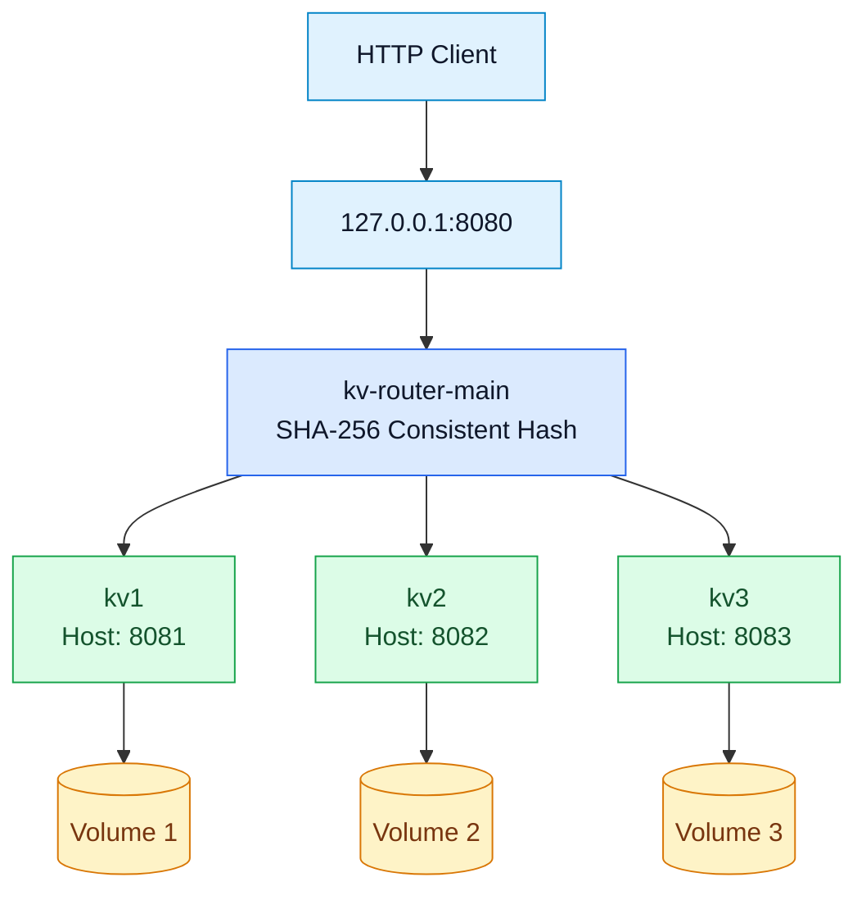

# Distributed Key-Value Store

A containerized, distributed key-value store built with **Python**, **aiohttp**, and **Docker**. An asynchronous HTTP router uses **SHA-256 consistent hashing** to assign keys to three independent storage servers. The system supports REST operations, persistent snapshots, operation logging, and controlled data rebalancing when cluster membership changes.

## Features

- HTTP `GET`, `POST`, `PUT`, and `DELETE` operations
- Three independent backend servers, accessed through one HTTP router
- SHA-256 consistent hashing with **128 virtual nodes per backend**
- Asynchronous request forwarding with a shared HTTP client session
- In-memory key-value storage with periodic JSON snapshots
- Atomic snapshot replacement and graceful shutdown persistence
- Persistent data and logs using separate Docker named volumes
- Preview and apply modes for data migration between hash-ring configurations
- Performance testing using the provided `kv_bench.py` client

## Project files

| File | Purpose |
| --- | --- |
| `app.py` | Asynchronous backend key-value server, persistence, and logging |
| `router_docker.py` | HTTP router that forwards requests to the responsible backend |
| `consistent_hash.py` | SHA-256 consistent hash ring with virtual nodes |
| `rebalance.py` | Key-migration utility with dry-run and apply modes |
| `kv_bench.py` | Benchmark client: 300 SET and 300 GET operations per run |
| `requirements.txt` | Python dependencies |
| `Dockerfile` | Backend server Docker image |
| `Dockerfile.router` | Router Docker image |
| `.dockerignore` | Files excluded from Docker build contexts |

## Architecture



The three backends communicate with the router over Docker network `kv-final-net`. Backend containers listen on port `8080` internally; their host ports are `8081`, `8082`, and `8083` for inspection and maintenance. Normal clients should use the router on host port `8080`.

## Requirements

- Docker Desktop running Linux containers
- Windows Command Prompt (CMD) for the commands below
- Python with the packages in `requirements.txt` for local testing and rebalancing

The Docker images use **Python 3.12**. To install Python dependencies locally:

```bat
python -m pip install -r requirements.txt
```

## Build the Docker images

Run these commands from the project directory:

```bat
docker build -f Dockerfile -t python-kv-store:latest .
docker build -f Dockerfile.router -t python-kv-router:latest .
```

Only the following application image names are required:

- `python-kv-store:latest`
- `python-kv-router:latest`

## Start a fresh three-server deployment

The following commands create new containers. **Do not run them unchanged if containers with the same names already exist**; use the existing containers instead.

Create the network:

```bat
docker network create kv-final-net
```

Start the three backend servers, each with its own persistent named volume:

```bat
docker run -d --name kv1 --network kv-final-net -p 127.0.0.1:8081:8080 -v kv-final-node1-data:/data python-kv-store:latest
docker run -d --name kv2 --network kv-final-net -p 127.0.0.1:8082:8080 -v kv-final-node2-data:/data python-kv-store:latest
docker run -d --name kv3 --network kv-final-net -p 127.0.0.1:8083:8080 -v kv-final-node3-data:/data python-kv-store:latest
```

Start the router configured for all three servers:

```bat
docker run -d --name kv-router-main --network kv-final-net -p 127.0.0.1:8080:8080 -e KV_NODES=kv1,kv2,kv3 python-kv-router:latest
```

Verify the deployment:

```bat
docker ps
docker images
docker volume ls --filter "name=kv-final-node"
```

For **already-created, stopped** containers, start the backends first and then the router:

```bat
docker start kv1 kv2 kv3
docker start kv-router-main
```

## REST API

Send normal requests to `http://127.0.0.1:8080/{key}`. The request body for a create or update is JSON containing a `value` field.

**Create a key:**

```bat
curl.exe -X POST http://127.0.0.1:8080/example -H "Content-Type: application/json" -d "{\"value\":\"hello\"}"
```

**Read a key:**

```bat
curl.exe http://127.0.0.1:8080/example
```

**Update a key:**

```bat
curl.exe -X PUT http://127.0.0.1:8080/example -H "Content-Type: application/json" -d "{\"value\":\"updated\"}"
```

**Delete a key:**

```bat
curl.exe -X DELETE http://127.0.0.1:8080/example
```

Successful create, read, and update responses contain the value, for example `{"value":"hello"}`. Deletion returns a success message. A missing key returns HTTP `404`; malformed JSON or a missing `value` field returns HTTP `400`.

For maintenance, each backend also exposes `GET /_admin/keys`, listing its local keys. For example:

```bat
curl.exe http://127.0.0.1:8081/_admin/keys
```

## Consistent hashing and distribution

`consistent_hash.py` hashes keys and virtual-node identifiers using SHA-256. Every physical backend contributes **128 virtual nodes** to the sorted hash ring. Keys are assigned to the first virtual node at or after their hash position, wrapping around at the end of the ring.

The router and rebalancing utility must use **the same node names and ring configuration**. Changing the node membership changes ownership for some keys; run the migration utility before switching live client traffic to the new configuration.

## Persistent storage and logs

Each backend has an independent Docker named volume mounted at `/data`:

| Backend | Docker volume |
| --- | --- |
| `kv1` | `kv-final-node1-data` |
| `kv2` | `kv-final-node2-data` |
| `kv3` | `kv-final-node3-data` |

The storage server uses:

- `/data/kv_data.json` for JSON snapshots
- `/data/kv_operations.log` for operation logs

Changed data is periodically persisted, using an asynchronous snapshot and atomic file replacement. Graceful shutdown also saves pending changes. The default snapshot interval in the Docker image is two seconds. Because snapshots are periodic, a sudden ungraceful termination can still lose the latest unsaved changes.

To inspect recent operations:

```bat
docker exec kv1 sh -c "tail -n 12 /data/kv_operations.log"
```

To restart one backend without deleting its storage volume:

```bat
docker restart kv1
```

**Do not delete the named Docker volumes** if you want to preserve stored records. In particular, do not use volume-pruning commands as part of ordinary cleanup.

## Controlled data rebalancing

`rebalance.py` supports a **dry run** (without `--apply`) and an **apply** mode that copies records to their new owners, verifies them, and removes obsolete copies.

**Before any migration, stop the router and prevent all other writes, including direct writes to backend ports. Keep all backends involved in migration running.** The migration uses the backend host ports to contact the servers.

### Remove `kv3` from the hash ring: three servers to two

```bat
docker stop kv-router-main
python rebalance.py --from-nodes kv1,kv2,kv3 --to-nodes kv1,kv2
python rebalance.py --from-nodes kv1,kv2,kv3 --to-nodes kv1,kv2 --apply
```

For a real, continuing two-server deployment, the router must then be **recreated with `KV_NODES=kv1,kv2`** before reopening client traffic. Do not restart a router still configured for all three nodes against the two-node key layout.

### Restore `kv3`: two servers to three

While client writes are still paused and all three backends remain running:

```bat
python rebalance.py --from-nodes kv1,kv2 --to-nodes kv1,kv2,kv3
python rebalance.py --from-nodes kv1,kv2 --to-nodes kv1,kv2,kv3 --apply
```

After verifying that records are correctly distributed across three nodes, restart the **original three-node router**:

```bat
docker start kv-router-main
```

This last command assumes the existing router was originally configured with `KV_NODES=kv1,kv2,kv3` and has not been recreated with a different configuration.

## Benchmark

The supplied `kv_bench.py` client performs **300 SET (POST)** operations followed by **300 GET** operations, using **three threads** per phase. Each run reports successful operations, mismatches, errors, throughput, average latency, and P99 latency.

With the router running, execute the benchmark inside a temporary Linux container using this **Windows CMD** command from the project directory:

```bat
docker run --rm --network container:kv-router-main -v "%cd%\kv_bench.py:/tmp/kv_bench.py:ro" python-kv-router:latest python /tmp/kv_bench.py
```

The benchmark writes keys `key_0` through `key_299`, overwriting their existing values. It is not read-only.

### Verified final benchmark results

Five runs were completed against the final Docker images and three-node cluster:

| Run | Total throughput |
| --- | ---: |
| 1 | 1,186.4 ops/s |
| 2 | 1,261.9 ops/s |
| 3 | 1,452.6 ops/s |
| 4 | 1,302.0 ops/s |
| 5 | 1,066.1 ops/s |
| **Arithmetic mean** | **1,253.8 ops/s** |
| **Median** | **1,261.9 ops/s** |

Across all five runs: **3,000 successful operations, zero errors, and zero mismatches**. Performance will vary with the host machine and Docker environment.

## Verified functional tests

The final deployment passed these checks:

| Test | Verified result |
| --- | --- |
| CRUD and errors | POST, GET, PUT, DELETE, malformed JSON, missing value, and missing-key responses passed |
| Key distribution | All 300 benchmark keys found on their SHA-256 owners: 92 on `kv1`, 107 on `kv2`, 101 on `kv3` |
| Persistence | All 92 benchmark keys on `kv1` remained available after `docker restart kv1` |
| Operation logging | Timestamped successful GET operations recorded in the persistent backend log |
| Three-to-two migration | 102 records migrated; 304 unique records preserved; no missing or misplaced records |
| Two-to-three restoration | 102 records restored; 304 unique records preserved; no missing or misplaced records |
| Final three-server layout | `kv1`: 94, `kv2`: 108, `kv3`: 102; no missing, unexpected, duplicate, or misplaced records |
| Router end-to-end check | 304 router responses matched the corresponding direct backend values |
| Docker integrity | Two `latest` application images, four running containers, and three persistent named volumes |

## Troubleshooting

- **Container name already exists:** Use `docker start <name>` for a stopped existing container rather than repeating `docker run --name ...`.
- **Request connection refused:** Check that `kv-router-main` and all three backend containers are running with `docker ps`.
- **Router returns an upstream error:** Check backend container status, Docker network membership, and the router's `KV_NODES` value.
- **Keys unavailable after membership change:** Keep writes paused and verify that rebalancing completed for the same source and target node sets used by the router.
- **Need backend logs:** Use `docker logs kv1` or read `/data/kv_operations.log` in the corresponding container.

## Notes

The benchmark, migration, and persistence checks described above were executed on the final `latest` Docker images. The reported performance is a measurement from that environment, not a guaranteed throughput level on other systems.
