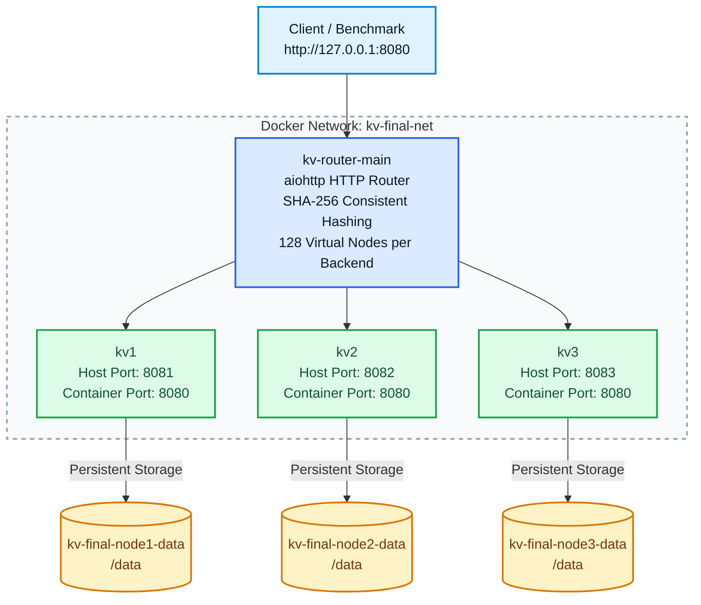

# Distributed Key-Value Store

**Implementation, execution, testing, and performance report**  
**Cloud Computing — Assignments 1, 2, and 3**  
**Development environment:** Windows CMD, VS Code, Python, Docker Desktop  
**Submitted By :** Samarth Kumar Samal
---

## Executive summary

This project began with a small HTTP key-value service and developed into a containerized, distributed storage system. The same Python storage server is used throughout. First, it provides an in-memory dictionary with a REST interface, periodic JSON persistence, and operation logs. Next, Docker packages the server and preserves its files in a named volume. Finally, a separate HTTP router distributes keys across three backend containers using SHA-256 consistent hashing, with a migration utility for controlled membership changes.

The final three-server deployment was tested through normal client requests, direct backend inspection, container restarts, and a complete migration from three servers to two and back again. At the time of the recorded functional verification, **304 distinct records** were recovered without missing, duplicated, or misplaced data. The original, unchanged benchmark completed **five 600-operation runs** with an arithmetic mean of **1,253.8 operations per second** when executed from a temporary Linux client container. A separate, modified benchmark completed **33,000 operations in 24.30 seconds**, or **1,358.1 operations per second**, with zero errors or mismatches. These are measurements from the tested environment, not performance guarantees.

This report is designed to be usable as an execution guide. Commands are written for **Windows Command Prompt (CMD)**, the shell used for the actual development and testing. Where two terminals are needed, this is stated explicitly. Each assignment has its own purpose, implementation explanation, runnable commands, expected results, and evidence.

## 1. Project overview and environment

### 1.1 Objectives

The goal was to implement a service that can accept a key and a JSON value, retrieve and modify that value, preserve it across clean restarts, and then scale the same approach to several independently running servers. Distribution is deterministic rather than random: a client sends a request to one router, and the router chooses the responsible backend based on the key's hash.

The three stages of the work are:

| Stage | Main focus | Primary files |
| --- | --- | --- |
| Assignment 1 | Standalone asynchronous key-value API, validation, persistence, logging | `app.py`, `requirements.txt` |
| Assignment 2 | Container packaging, port mapping, persistent named volumes | `Dockerfile`, `.dockerignore`, `app.py`, `requirements.txt` |
| Assignment 3 | Distributed routing, consistent hashing, rebalancing, benchmarking | `router_docker.py`, `consistent_hash.py`, `rebalance.py`, `Dockerfile.router`, `kv_bench.py` |

### 1.2 Source files

| File | Role in the implementation |
| --- | --- |
| `app.py` | Asynchronous HTTP server, in-memory records, request validation, snapshots, and logs |
| `router_docker.py` | Routes client operations to the selected backend |
| `consistent_hash.py` | SHA-256 ring and virtual-node ownership calculation |
| `rebalance.py` | Dry-run and apply modes for copying, checking, and removing migrated keys |
| `Dockerfile` | Backend image based on Python 3.12 slim |
| `Dockerfile.router` | Router image based on Python 3.12 slim |
| `.dockerignore` | Prevents local-only files from entering Docker build contexts |
| `requirements.txt` | Python dependencies, including `aiohttp` and `requests` |
| `kv_bench.py` | Original benchmark: 300 POST and 300 GET operations, three threads |
| `kv_bench_32500.py` | Optional local copy for larger experiments; not part of the original benchmark |

### 1.3 Starting in the correct directory

Open VS Code in the `cloud-kv-store` folder and open **Terminal → New Terminal**. Select **Command Prompt**, not PowerShell, for the commands in this report. The working directory should contain `app.py`, the two Dockerfiles, and `requirements.txt`.

```bat
cd "C:\Users\samsa\Documents\CSCI 5144 - Cloud Computing\cloud-kv-store"
dir /b
python --version
docker --version
```

If the local virtual environment has not been activated, use:

```bat
kvstore\Scripts\activate
python -m pip install -r requirements.txt
```

The `kvstore` directory is a local Python environment, **not** a source file to include in a submission. The production Docker images use `python:3.12-slim`; the active local Python version can be inspected with `python --version`.

For Docker tests, start Docker Desktop and confirm its Linux engine is running:

```bat
docker info
docker ps
```

**Execution safety:** The following report contains both **fresh-deployment commands** (`docker run`, `docker network create`) and **existing-deployment commands** (`docker start`). Use the appropriate set. Running the fresh commands a second time with existing container names will fail; do not delete production containers or volumes just to make those commands work.

### 1.4 Final system architecture



The router and all backend containers share the Docker bridge network named `kv-final-net`. Clients normally use the router at `127.0.0.1:8080`. Backend host ports `8081`–`8083` are available for testing, inspection, and controlled migration. In the containers, the HTTP service listens on port `8080`.

---

## 2. Assignment 1 — Standalone Python key-value service

### 2.1 What was implemented

The starting point is an asynchronous HTTP service built with `aiohttp`. A Python dictionary holds the active key-value records. `POST` creates or overwrites a value, `GET` retrieves it, `PUT` updates it, and `DELETE` removes it. The server responds with JSON and returns clear HTTP status codes for invalid requests or unknown keys.

The implementation also addresses two practical concerns that a dictionary alone would not solve. First, it writes changed records to a JSON file at intervals and writes a final snapshot on graceful shutdown. Snapshots are created through a temporary file and then atomically replace the previous snapshot. Second, it writes timestamped operation logs using a queue-based logging listener so normal request handling is not held up by file writes.

| HTTP operation | Route | Request body | Expected result |
| --- | --- | --- | --- |
| POST | `/{key}` | `{"value":"hello"}` | HTTP 200, returned value |
| GET | `/{key}` | None | HTTP 200 with value, or 404 if missing |
| PUT | `/{key}` | `{"value":"updated"}` | HTTP 200, returned updated value |
| DELETE | `/{key}` | None | HTTP 200, deletion message; 404 if missing |
| Invalid POST/PUT | `/{key}` | Malformed JSON or no `value` | HTTP 400 |

### 2.2 Run the standalone server without disturbing Docker

The final Docker router already occupies port `8080`, so the standalone demonstration deliberately uses **port 8090** and **separate local test files**. Do not stop the Docker cluster for this test.

**Terminal A — from the project directory:**

```bat
set "PORT=8090"
set "KV_DATA_FILE=%CD%\a1_test_data.json"
set "KV_LOG_FILE=%CD%\a1_test_operations.log"
set "KV_SAVE_INTERVAL=2"
python app.py
```

Leave Terminal A running. The environment variables remain active in that CMD window. `PORT=8090` isolates the test from Docker, and the file paths avoid modifying production container data. The initial run should display the usual `aiohttp` startup behavior; a new empty test store is normal.

**Terminal B — another Windows CMD terminal in the same project:**

### 2.3 Execute the REST operations

**Test A1.1 — Create a value (POST):**

```bat
curl.exe -i -X POST http://127.0.0.1:8090/a1_demo ^
  -H "Content-Type: application/json" ^
  -d "{\"value\":\"hello\"}"
```

Expected: HTTP `200`, with a JSON response containing `"value":"hello"`.

**Test A1.2 — Read the value (GET):**

```bat
curl.exe -i http://127.0.0.1:8090/a1_demo
```

Expected: HTTP `200` and `{"value":"hello"}`.

**Test A1.3 — Update the same key (PUT):**

```bat
curl.exe -i -X PUT http://127.0.0.1:8090/a1_demo ^
  -H "Content-Type: application/json" ^
  -d "{\"value\":\"updated\"}"
curl.exe -i http://127.0.0.1:8090/a1_demo
```

Expected: HTTP `200` for both requests, and the GET response contains `{"value":"updated"}`.

**Test A1.4 — Reject malformed JSON:**

```bat
curl.exe -i -X POST http://127.0.0.1:8090/a1_bad_json ^
  -H "Content-Type: application/json" ^
  -d "not-json"
```

Expected: HTTP `400`. A malformed body should not create a record.

**Test A1.5 — Reject an object without a `value` field:**

```bat
curl.exe -i -X POST http://127.0.0.1:8090/a1_missing_value ^
  -H "Content-Type: application/json" ^
  -d "{\"other\":\"test\"}"
```

Expected: HTTP `400`.

### 2.4 Test persistence across a graceful restart

Keep `a1_demo` in the store with value `updated`. In **Terminal A**, press **Ctrl+C** to stop the service cleanly. Start the same server again in **the same terminal**, preserving the environment settings:

```bat
python app.py
```

From **Terminal B**, verify that the value survived:

```bat
curl.exe -i http://127.0.0.1:8090/a1_demo
type a1_test_data.json
```

Expected: GET returns HTTP `200` and `{"value":"updated"}`; the JSON snapshot contains the saved record. The file is created as part of the server's normal snapshot process. A graceful shutdown is deliberately used because periodic snapshots do not guarantee that the final unflushed writes survive a sudden power loss or forced termination.

### 2.5 Test deletion and operation logs

```bat
curl.exe -i -X DELETE http://127.0.0.1:8090/a1_demo
curl.exe -i http://127.0.0.1:8090/a1_demo
type a1_test_operations.log
```

Expected: DELETE returns HTTP `200`, the subsequent GET returns HTTP `404`, and the log shows timestamps, methods, key names, and status codes. To close the standalone demonstration, press **Ctrl+C** in Terminal A again.

### 2.6 Assignment 1 results and observations

During local development, the operation log recorded successful POST, GET, PUT, DELETE, HTTP 400 validation responses, and HTTP 404 responses. A restart log also recorded that the server loaded one saved key; a subsequent GET retrieved `persistence_test` successfully. Those observations support the standalone API and graceful persistence behavior. The commands above use separate `a1_` test keys so they are safe to repeat without changing the Docker-based demonstration.

**Assignment 1 outcome:** The storage server fulfills the implemented REST behavior, maintains records in memory while serving requests, persists them to disk, and records an operation history. This establishes the base component reused in the next two stages.

---

## 3. Assignment 2 — Docker packaging and persistent storage

### 3.1 Why containerization was added

Running a Python script directly requires the host system to have the right Python installation and dependencies. Docker provides a repeatable runtime: the backend `Dockerfile` starts from `python:3.12-slim`, installs `requirements.txt`, copies `app.py`, and launches the server on port `8080`. The application writes snapshots and logs under `/data`, which can be mounted to a named Docker volume so the files are not tied to the container's writable layer.

A Docker image packages the application; a **container** is a running instance of the image; a **named volume** stores its persistent files. These are separate concepts. Restarting or removing a container does not automatically delete a named volume, but deliberately removing the volume will remove its stored data.

### 3.2 Build and inspect the backend image

From the project folder, with Docker Desktop running:

```bat
docker build -f Dockerfile -t python-kv-store:latest .
docker images
```

Expected: the image list includes `python-kv-store:latest`. The Dockerfile uses `KV_DATA_FILE=/data/kv_data.json`, `KV_LOG_FILE=/data/kv_operations.log`, `KV_SAVE_INTERVAL=2`, and `PORT=8080`.

**If the final `latest` image already exists and its source has not changed, there is no need to rebuild it.** The command is included to make this report reproducible on a fresh machine.

### 3.3 Run an isolated Assignment 2 container

Use a demo name and host port that do not conflict with the final cluster. This separate example does not touch the production containers `kv1`, `kv2`, or `kv3`.

```bat
docker run -d --name kv-a2-demo ^
  -p 127.0.0.1:8091:8080 ^
  -v kv-a2-demo-data:/data ^
  python-kv-store:latest

docker ps
```

The Docker named volume `kv-a2-demo-data` will be created automatically if it does not already exist. If a previous `kv-a2-demo` container exists, use `docker start kv-a2-demo` rather than repeating `docker run --name`.

### 3.4 Test the containerized REST API

```bat
curl.exe -i -X POST http://127.0.0.1:8091/a2_demo ^
  -H "Content-Type: application/json" ^
  -d "{\"value\":\"stored_in_docker\"}"
curl.exe -i http://127.0.0.1:8091/a2_demo
```

Expected: HTTP `200` for both requests; GET returns the value `stored_in_docker`.

### 3.5 Verify the volume and persistence

```bat
docker inspect kv-a2-demo --format "{{json .Mounts}}"
docker exec kv-a2-demo sh -c "ls -l /data"
docker restart kv-a2-demo
curl.exe -i http://127.0.0.1:8091/a2_demo
```

The inspect command should show the volume mounted at `/data`. After the restart, the stored key should still be available. To demonstrate that persistence is independent of the container instance, stop and remove only the demo container, then recreate it using **the same volume**:

```bat
docker stop kv-a2-demo
docker rm kv-a2-demo
docker run -d --name kv-a2-demo ^
  -p 127.0.0.1:8091:8080 ^
  -v kv-a2-demo-data:/data ^
  python-kv-store:latest
curl.exe -i http://127.0.0.1:8091/a2_demo
```

Expected: the key remains readable after recreation. The demo can then be stopped and removed without removing its volume:

```bat
docker stop kv-a2-demo
docker rm kv-a2-demo
docker volume ls
```

**Data safety:** Do not run `docker volume prune`, `docker system prune --volumes`, or `docker volume rm kv-a2-demo-data` unless you intentionally want to delete that demo's persistent data. The same warning applies even more strongly to the three production volumes.

### 3.6 Logs and basic troubleshooting

```bat
docker logs kv1
docker exec kv1 sh -c "tail -n 12 /data/kv_operations.log"
docker inspect kv1 --format "{{json .Mounts}}"
```

The last two commands refer to the **existing production backend `kv1`**, not the removed demo container. They are useful for checking the persistent data directory and the recorded operations during the final cluster demonstration.

**Assignment 2 outcome:** The backend server can be packaged once, run as an isolated Linux container, reached through a mapped host port, and restarted without losing saved JSON records. The final deployment extends this arrangement to three separate named volumes.

---

## 4. Assignment 3 — Distributed routing, consistent hashing, and migration

### 4.1 System design

A router provides one HTTP entry point while three backend containers maintain independent dictionaries and JSON snapshot files. The router reads the configured backend names from `KV_NODES`, uses a consistent hash ring to select one server for each key, and forwards the original HTTP request. A shared `aiohttp` client session reuses backend connections rather than creating a new connection for every request.

The ring uses SHA-256 and **128 virtual nodes for each physical backend**. For a three-node cluster this yields 384 virtual-node positions. Keys and virtual-node identifiers are hashed into the same space; `bisect_left` locates the first position at or after a key's hash, with wraparound. This is deterministic, so both the router and migration tool can agree on ownership as long as they use the same node names and hashing rules.

Adding or removing a backend changes ownership of only some keys, not all keys. It does **not** automatically transfer stored records: that is the responsibility of `rebalance.py`.

### 4.2 Build the two Docker application images

```bat
docker build -f Dockerfile -t python-kv-store:latest .
docker build -f Dockerfile.router -t python-kv-router:latest .
docker images
```

The final image names have no numeric version suffixes: `python-kv-store:latest` and `python-kv-router:latest`.

### 4.3 Fresh three-server setup — use only if not already created

Create the network once:

```bat
docker network create kv-final-net
```

Create the three backend containers, giving each a unique host port and named volume:

```bat
docker run -d --name kv1 --network kv-final-net ^
  -p 127.0.0.1:8081:8080 ^
  -v kv-final-node1-data:/data python-kv-store:latest

docker run -d --name kv2 --network kv-final-net ^
  -p 127.0.0.1:8082:8080 ^
  -v kv-final-node2-data:/data python-kv-store:latest

docker run -d --name kv3 --network kv-final-net ^
  -p 127.0.0.1:8083:8080 ^
  -v kv-final-node3-data:/data python-kv-store:latest
```

Start the router on host port `8080`:

```bat
docker run -d --name kv-router-main --network kv-final-net ^
  -p 127.0.0.1:8080:8080 ^
  -e KV_NODES=kv1,kv2,kv3 python-kv-router:latest
```

**Existing deployment instead:** If all four containers were already created and are stopped, do not repeat the `docker run` commands. Start the existing containers:

```bat
docker start kv1 kv2 kv3
docker start kv-router-main
```

### 4.4 Check the running cluster and its data volumes

```bat
docker ps --format "table {{.Names}}\t{{.Image}}\t{{.Status}}"
docker images
docker volume ls --filter "name=kv-final-node"
docker network inspect kv-final-net
```

The verified final setup contained exactly four running application containers, two application images tagged `latest`, and these three volumes: `kv-final-node1-data`, `kv-final-node2-data`, `kv-final-node3-data`.

### 4.5 Test routing through the single HTTP entry point

Use the router port `8080`, not a direct backend port, for normal operations:

```bat
curl.exe -i -X POST http://127.0.0.1:8080/report_demo ^
  -H "Content-Type: application/json" ^
  -d "{\"value\":\"routed\"}"
curl.exe -i http://127.0.0.1:8080/report_demo
curl.exe -i -X PUT http://127.0.0.1:8080/report_demo ^
  -H "Content-Type: application/json" ^
  -d "{\"value\":\"updated_through_router\"}"
curl.exe -i http://127.0.0.1:8080/report_demo
curl.exe -i -X DELETE http://127.0.0.1:8080/report_demo
curl.exe -i http://127.0.0.1:8080/report_demo
```

Expected: the create, read, update, and delete operations succeed; the final GET returns HTTP `404`. This example removes its own test key afterward, helping keep the production record set tidy.

### 4.6 Inspect physical key placement

The backend-only administrative endpoint lists keys **physically held by that backend**. It is primarily a test and maintenance tool.

```bat
curl.exe http://127.0.0.1:8081/_admin/keys
curl.exe http://127.0.0.1:8082/_admin/keys
curl.exe http://127.0.0.1:8083/_admin/keys
```

For a brief inventory of the current counts:

```bat
python -c "import requests; print([(p, len(requests.get('http://127.0.0.1:%d/_admin/keys' % p, timeout=10).json()['keys'])) for p in (8081,8082,8083)])"
```

A more rigorous placement check compares the observed inventories to a locally reconstructed 128-virtual-node SHA-256 ring. Run this **only after the original `kv_bench.py` has populated `key_0` through `key_299`**, and while the normal three-node router configuration is active:

```bat
python -c "import requests,hashlib,bisect; h=lambda x:int(hashlib.sha256(x.encode()).hexdigest(),16); n=('kv1','kv2','kv3'); r=sorted((h(f'{x}:{i}'),x) for x in n for i in range(128)); p=[v[0] for v in r]; a={x:set(requests.get(f'http://127.0.0.1:{8081+j}/_admin/keys',timeout=10).json()['keys']) for j,x in enumerate(n)}; pairs=[(f'key_{i}',r[bisect.bisect_left(p,h(f'key_{i}'))%len(r)][1]) for i in range(300)]; bad=[k for k,owner in pairs if k not in a[owner] or sum(k in v for v in a.values())!=1]; print('Wrong/missing/duplicated benchmark keys:',len(bad)); assert not bad; print('DISTRIBUTION PASSED')"
```

For the original 300 benchmark keys, the verified distribution was **92 on `kv1`, 107 on `kv2`, and 101 on `kv3`**, with zero placement failures. These particular counts describe the key names `key_0`–`key_299`, not an invariant balance ratio for every workload.

### 4.7 Check persistence and logs in the distributed deployment

```bat
docker restart kv1
curl.exe http://127.0.0.1:8081/_admin/keys
docker exec kv1 sh -c "tail -n 12 /data/kv_operations.log"
```

In the recorded test, the 92 original benchmark keys assigned to `kv1` remained available after restart, and every one of those keys was readable through the router. Timestamped GET log entries with HTTP `200` also appeared in the named volume.

### 4.8 Rebalance safely from three servers to two

**Safety condition:** Stop the router and pause all other writers, including any clients talking directly to ports `8081`–`8083`. Keep all three storage containers running, including the departing `kv3`, because the migration tool needs to read its records. Do not run the benchmark while migration is underway.

Stop the router:

```bat
docker stop kv-router-main
```

Preview migration (read-only):

```bat
python rebalance.py --from-nodes kv1,kv2,kv3 --to-nodes kv1,kv2
```

Review the planned copies. If the plan is correct, apply it:

```bat
python rebalance.py --from-nodes kv1,kv2,kv3 --to-nodes kv1,kv2 --apply
```

The program copies records, checks them on the destination, then removes obsolete copies. It should finish with a message like `MIGRATION PASSED: ... no missing or misplaced records.` The number of records moved depends on what is currently stored. In the recorded 304-record demonstration, **102 records moved** and the two remaining servers held **146 and 158 records**, with `kv3` empty.

**Do not simply restart the old router now.** Its existing environment still says `KV_NODES=kv1,kv2,kv3`, which would conflict with the new two-server ownership layout.

### 4.9 Two ways to continue after the 3-to-2 migration

**Option A — brief assignment demonstration (recommended here):** Leave the original router stopped, verify the new backend inventories through `/_admin/keys`, then proceed directly to the restoration below. This is the workflow used in the recorded migration test and avoids changing container definitions.

**Option B — operate as a two-server cluster:** Recreate **only the router container**, configured for two backends, after the migration has passed:

```bat
docker rm kv-router-main
docker run -d --name kv-router-main --network kv-final-net ^
  -p 127.0.0.1:8080:8080 ^
  -e KV_NODES=kv1,kv2 python-kv-router:latest
```

For this optional workflow, stop the two-node router before restoring the third node. When the data has been migrated back, remove and recreate the router again with `KV_NODES=kv1,kv2,kv3`; merely restarting a two-node-configured router will not update its environment.

### 4.10 Restore the third server: two to three

For **Option A**, the router is still stopped. Preview the restoration:

```bat
python rebalance.py --from-nodes kv1,kv2 --to-nodes kv1,kv2,kv3
```

Apply the restoration:

```bat
python rebalance.py --from-nodes kv1,kv2 --to-nodes kv1,kv2,kv3 --apply
```

Verify backend inventories using the three `/_admin/keys` commands in §4.6. The recorded restoration moved **102 records** back to `kv3`; the 304 records returned to a three-server distribution of **94 / 108 / 102**, with zero missing, unexpected, duplicated, or misplaced records.

For **Option A**, restart the untouched original router:

```bat
docker start kv-router-main
```

For **Option B**, where the router was recreated with two nodes, stop and recreate it with the original three-node configuration instead:

```bat
docker stop kv-router-main
docker rm kv-router-main
docker run -d --name kv-router-main --network kv-final-net ^
  -p 127.0.0.1:8080:8080 ^
  -e KV_NODES=kv1,kv2,kv3 python-kv-router:latest
```

**Keep the named backend volumes untouched throughout.** After restoring the three-node ring, normal client traffic can resume.

### 4.11 Original benchmark — Windows and Docker

The original `kv_bench.py` was preserved unchanged. Each default run sends **300 SET (POST) requests and 300 GET requests**, using **three threads** in each phase, for 600 operations total.

Run on **Windows CMD**, with the router already running:

```bat
python kv_bench.py
```

Run the **same original benchmark inside a temporary Linux client container**:

```bat
docker run --rm --network container:kv-router-main ^
  -v "%cd%\kv_bench.py:/tmp/kv_bench.py:ro" ^
  python-kv-router:latest python /tmp/kv_bench.py
```

The benchmark client uses the router at `http://127.0.0.1:8080`. `--network container:kv-router-main` gives the temporary Linux client access to the router container's network namespace; therefore, its loopback address reaches the router. The `--rm` flag removes this temporary benchmark container after execution. The named data volumes remain untouched except for the test writes.

A successful default run reports `SET: ok=300`, `GET: ok=300`, with `mismatch=0` and `error=0`. Because the test writes existing `key_0`–`key_299` names, **it overwrites those benchmark keys**.

### 4.12 Larger benchmark — exactly 32,500 operations

For a longer test, make a **separate copy** rather than editing the instructor-provided file:

```bat
copy kv_bench.py kv_bench_32500.py
```

Open `kv_bench_32500.py` in VS Code. In its configuration section, use:

```python
NUM_THREADS = 3
NUM_KEYS = 16_250
```

Remove any old line such as `NUM_KEYS = NUM_THREADS * OPS_PER_THREAD`; otherwise, the workload will be multiplied by the thread count. If `OPS_PER_THREAD` is no longer referenced, remove that declaration as well. Keep `BASE_URL = 'http://127.0.0.1:8080'` for the router test.

Then execute the **Windows benchmark**:

```bat
python kv_bench_32500.py
```

And the **Docker benchmark**:

```bat
docker run --rm --network container:kv-router-main ^
  -v "%cd%\kv_bench_32500.py:/tmp/kv_bench_32500.py:ro" ^
  python-kv-router:latest python /tmp/kv_bench_32500.py
```

The correctly configured test executes **16,250 SET + 16,250 GET = 32,500 operations**. Both tests must use the *same file and key count* for a fair Windows-vs-Docker comparison. The 32,500-operation configuration is an execution instruction; a completed run at exactly this count is **not claimed** in the recorded results below.

### 4.13 What the benchmark measures

Throughput is the number of successful operations divided by elapsed phase time. Average latency is the mean round-trip time for successful requests, and P99 latency approximates the response-time threshold at the 99th percentile. These metrics measure different qualities: a run may have high throughput but also occasional slow responses.

The Windows process sends HTTP requests across the Windows-to-Docker networking path. The Linux client container instead runs within Docker's networking environment. Results also vary because of CPU scheduling, Docker Desktop settings, machine load, concurrency, storage activity, and the number of keys. A larger operation count is **not the same thing** as higher operations per second.

---

## 5. Recorded test results and discussion

### 5.1 Original 600-operation Docker benchmark

Five separate runs of the **unaltered** benchmark were recorded against the final three-server deployment:

| Run | Successful operations | Throughput |
| --- | ---: | ---: |
| 1 | 600 | 1,186.4 ops/s |
| 2 | 600 | 1,261.9 ops/s |
| 3 | 600 | 1,452.6 ops/s |
| 4 | 600 | 1,302.0 ops/s |
| 5 | 600 | 1,066.1 ops/s |
| **Arithmetic mean** | **3,000 across five runs** | **1,253.8 ops/s** |

Every run completed with zero errors and zero value mismatches. The mean is the simple average of the five reported throughput values, rather than the throughput from a single aggregated elapsed time.

### 5.2 Additional sustained-load observations

Further experiments used a **modified copy** of the benchmark, not the original instructor script:

| Client / workload | SET | GET | Total | Time | Throughput | Errors / mismatches |
| --- | ---: | ---: | ---: | ---: | ---: | --- |
| Windows CMD, 33,000 keys | 33,000 | 33,000 | 66,000 | 107.07 s | 616.4 ops/s | 0 / 0 |
| Linux client container, 16,500 keys | 16,500 | 16,500 | 33,000 | 24.30 s | 1,358.1 ops/s | 0 / 0 |

The Linux run reported SET average latency **2.20 ms** with P99 **5.54 ms**, and GET average latency **2.21 ms** with P99 **5.88 ms**. The Windows run reported SET average latency **5.30 ms** with P99 **11.21 ms**, and GET average latency **4.42 ms** with P99 **8.64 ms**.

These are useful observations of sustained correctness and measured throughput, but **the two rows are not an apples-to-apples comparison** because their operation counts differ. A separate 33,000-operation run reported 627.2 ops/s, but its environment was not independently established in the supplied result and is therefore not labeled as a Docker-internal measurement here.

### 5.3 Functional verification summary

| Verification | Recorded result |
| --- | --- |
| CRUD and validation | POST, GET, PUT, DELETE, malformed JSON, missing `value`, and missing-key responses passed |
| SHA-256 key ownership | For 300 benchmark keys, `kv1` 92, `kv2` 107, `kv3` 101; zero placement errors |
| Persistence | After `docker restart kv1`, all 92 original benchmark keys on that node remained readable |
| Persistent logging | Timestamped HTTP GET status-200 entries verified in `/data/kv_operations.log` |
| Three-to-two migration | 102 copies migrated; 304 records preserved; zero missing or misplaced records |
| Two-server validation | 146 records on `kv1`, 158 on `kv2`, zero on `kv3` |
| Two-to-three restoration | 102 records returned; 304 records preserved; zero missing or misplaced records |
| Restored layout | 94 / 108 / 102 across the three nodes; zero duplicates or unexpected keys |
| End-to-end routing | 304 router values matched direct backend values |
| Docker state | Two `latest` application images, four running containers, three persistent named volumes |

The 304-record integrity checks were recorded **before the later large benchmarks**. After a large benchmark writes thousands of new keys, the live cluster will naturally hold more than 304 keys. This is expected and should not be mistaken for a mismatch with the earlier evidence.

### 5.4 Interpretation

The tests show a system that behaves consistently under CRUD requests and preserves its key ownership rules when the ring changes. The migration test is especially important: it verifies that reducing the cluster does not merely make the router point to new locations but also moves the actual stored records. Successful restoration demonstrates the reverse direction as well.

The throughput measurements show that the router, Python server, and benchmark client's placement all contribute to observed performance. In the recorded Linux run, the cluster sustained more than 1,300 successful operations per second across 33,000 operations, while a Windows-local client measured a lower rate in a different workload. Neither figure should be presented as a guaranteed capacity limit.

---

## 6. Operational commands, checks, and troubleshooting

### 6.1 Start, stop, and inspect existing containers

These commands are for **containers that have already been created**:

```bat
docker start kv1 kv2 kv3
docker start kv-router-main
docker ps
docker logs kv-router-main
docker logs kv1
```

To stop the router before a planned migration, use `docker stop kv-router-main`. To stop the cluster intentionally, stop the router first and then the backends:

```bat
docker stop kv-router-main
docker stop kv1 kv2 kv3
```

Restarting the existing services later does not require rebuilding images or creating new named volumes.

### 6.2 Inspect keys, logs, mounts, and configuration

```bat
curl.exe http://127.0.0.1:8081/_admin/keys
curl.exe http://127.0.0.1:8082/_admin/keys
curl.exe http://127.0.0.1:8083/_admin/keys
docker exec kv1 sh -c "tail -n 12 /data/kv_operations.log"
docker inspect kv1 --format "{{json .Mounts}}"
docker inspect kv-router-main --format "{{json .Config.Env}}"
docker volume ls --filter "name=kv-final-node"
```

The administrative keys endpoint is a maintenance aid and is not intended as a publicly exposed management API. All published host ports in this deployment are bound to `127.0.0.1`.

### 6.3 Common problems and responses

| Symptom | Likely cause | First action |
| --- | --- | --- |
| Port `8080` already in use | Docker router or another service already bound it | `docker ps`; use port `8090` for standalone Python testing |
| `Conflict: container name already in use` | Container already exists | Use `docker start <name>` if stopped; inspect with `docker ps -a` |
| Router returns 502 or 504 | Backend unavailable, network problem, or request timeout | `docker ps`; `docker logs kv-router-main`; `docker logs kv1` |
| GET returns 404 after membership change | Router ring and data layout disagree | Pause writes; verify `KV_NODES` and complete rebalancing |
| Snapshot file seems missing | No changed data yet or wrong volume/path | Check `/data`, environment variables, and mounts |
| Benchmark runs more keys than expected | `NUM_KEYS` is multiplied by thread count | Set `NUM_KEYS = 16_250` explicitly for 32,500 total operations |
| Docker and Windows benchmarks differ | Client location, host load, concurrency, or workload differs | Use identical benchmark files and compare multiple runs |

**Preserve user data:** Do not run `docker volume prune`, `docker system prune --volumes`, or delete the `kv-final-node*-data` volumes as a routine cleanup step. If the system is in the middle of migration, finish the planned migration or recovery before changing router membership again.

---

## 7. Limitations and possible improvements

The implementation is functional for the demonstrated coursework scenarios, but it is not a production-grade replicated database. Each key has one owner at a time, so a failed backend may temporarily make that backend's keys unavailable. The router is also a single client entry point. Migration is a controlled maintenance procedure, **not an automatic response to membership changes**, and it requires incoming writes to be paused. JSON snapshots are periodic, so a sudden failure between saves may lose the most recent changes.

Further work could include replication, health-aware routing and failover, authentication for administrative endpoints, coordinated online migration, and richer performance studies with multiple client concurrency levels. These are potential enhancements, not features claimed to be present in the current code.

## 8. Submission and demonstration checklist

A clean source submission should normally contain the program files below, together with the report and README. The exact instructor instructions still determine the final deliverables.

| Include | Normally exclude from a source package |
| --- | --- |
| `app.py`, `router_docker.py`, `consistent_hash.py`, `rebalance.py` | `kvstore/` virtual environment |
| `Dockerfile`, `Dockerfile.router`, `.dockerignore` | `__pycache__/` bytecode |
| `requirements.txt`, unchanged `kv_bench.py` | Local `kv_data.json` and operation logs |
| `README.md`, this report | Obsolete Dockerfile experiments and backup archives |
| Optional clearly labeled `kv_bench_32500.py` | Personal machine-specific cache files |

For a live demonstration, show the standalone service on port `8090`, the Docker image and container list, routed POST/GET through port `8080`, inventories of the three backend servers, a named-volume restart, a dry-run migration, and the final benchmark output. Capture actual terminal output if screenshots or evidence are required; do not substitute expected sample output for measurements.

## 9. Conclusion

Across the three stages, the project progressed from an individual asynchronous Python API to a repeatable Docker deployment and then to a distributed key-value store with deterministic key placement. The important result is not just that requests work through the router: the recorded tests show that data remains available after a controlled restart and can be moved between hash-ring configurations without loss in the demonstrated scenario.

The final solution uses two clean Docker images, four application containers, and three dedicated data volumes. The original benchmark stayed unchanged, and the larger tests were run from a separate copy so the course-provided workload could still be reproduced. The resulting system is small enough to understand and demonstrate, while covering practical issues in distributed systems: routing consistency, storage durability, operational safety, and measured performance.

---

**Report basis:** supplied `README.md`, available implementation files, and terminal outputs from the completed test sessions. All commands are intended for Windows CMD unless a snippet is explicitly labeled Python or a command runs inside Docker. Recorded counts and performance numbers describe the tested state and may change after further benchmarks or new writes.
